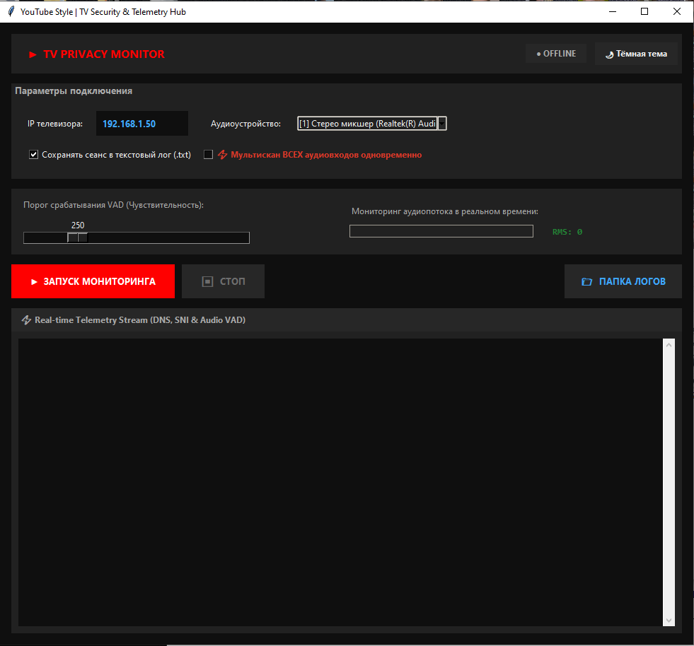
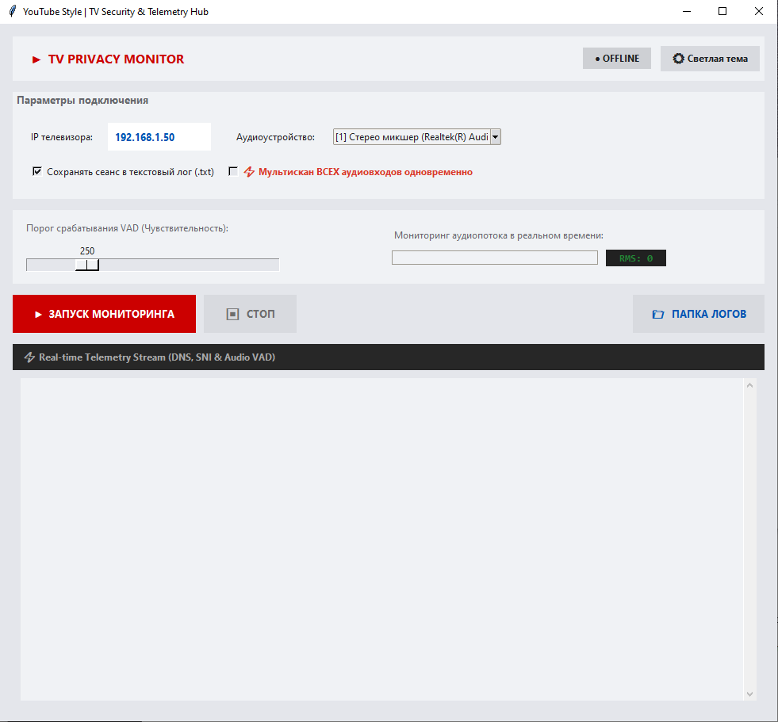

# 🛡️ Spiip — Smart TV Privacy Monitor & Telemetry Inspector

[](https://www.python.org/)
[](LICENSE)
[]()

**Spiip** is a lightweight, portable desktop utility designed to monitor, intercept, and analyze network telemetry (DNS & TLS SNI) and ambient audio activity (via Voice Activity Detection) originating from Smart TVs and IoT devices on your local network. 

Built with a sleek, modern interface inspired by media streaming platforms, Spiip gives you real-time visibility into what your smart devices are transmitting and hearing.

---

## ✨ Key Features

- **🌐 Deep Packet Inspection (DPI):** Real-time monitoring of network traffic filtered by your target Smart TV's IP address.
- **🔍 Port Decoder & Service Identification:** Translates raw port numbers into readable service labels (e.g., Google Cast/Chromecast, Samsung SmartHub, LG SmartShare, mDNS, SSDP/UPnP).
- **🔒 TLS SNI & DNS Parsing:** Extracts domain names from unencrypted DNS queries and encrypted TLS Client Hello packets (Server Name Indication) to reveal the actual external servers your TV talks to.
- **🎙️ Audio VAD & RMS Meter:** Monitors audio inputs in real-time, displaying a live RMS volume bar with an adjustable sensitivity threshold.
- **💾 Automatic Session Recording:** Automatically saves triggered audio spikes into `.wav` clips and records all session telemetry into structured `.txt` log files.
- **⚡ Multi-Device Audio Scan:** Option to simultaneously monitor all available system audio inputs.
- **🎨 Dynamic Theme Engine:** Instant switching between **YouTube Dark Theme** (`#0f0f0f`) and **Soft Gray Light Theme** (`#e4e6eb`) on the fly.
- **📦 Portable Executable:** Runs out-of-the-box or can be bundled into a single standalone `.exe` file via PyInstaller.

---

## 📷 Screenshots

| Dark Mode (YouTube Theme) | Soft Gray Mode |
| :---: | :---: |
|  |  |

---

## 🛠️ Tech Stack

- **Language:** Python 3.8+
- **GUI Framework:** Tkinter / ttk (Custom styled modern layout)
- **Networking:** Scapy (Packet sniffing & payload parsing)
- **Audio Processing:** SoundDevice & NumPy (Real-time stream handling and RMS calculation)

---

## 🚀 Installation & Setup

### Prerequisites (Windows)
1. **Python 3.8 or higher** installed on your system.
2. **Npcap** (required by Scapy for packet capturing on Windows). Make sure to check *"Support WinPcap API-compatible mode"* during installation.

### Running from Source
1. Clone the repository or download the source code:
   ```bash
   git clone [https://github.com/your-username/Spiip.git](https://github.com/your-username/Spiip.git)
   cd Spiip

   ## Sponsor this project

* ko_fi: kansensus
* https://solscan.io/account/49UemFHmDeW3ESsJedyvir86F8EeHaksTBPnpJdTJdPw
